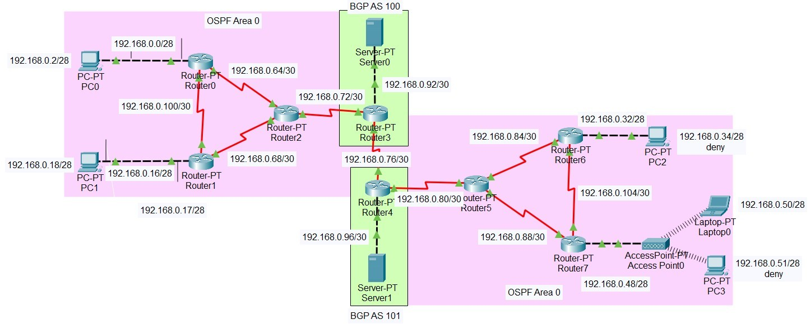

# Cisco Packet Tracer Network Simulation

## Overview
This project demonstrates a network design and simulation developed using Cisco Packet Tracer as a final project of computer networking lab subject.

The network topology was designed using Variable Length Subnet Masking (VLSM) and implemented with multiple routers, end devices, access points, and servers.

The project explores dynamic routing, route redistribution, access control, and Network Address Translation (NAT) to demonstrate network connectivity and traffic management across multiple subnets.

## Objectives
1. Design a network topology based on the project requirements
2. Configure network devices and IP addressing
3. Test network connectivity and verify the configuration

## Tools and Technologies
1. Cisco Packet Tracer
2. Networking Protocols and Concepts:
   a. IPv4 Addressing and Subnetting
   b. Variable Length Subnet Masking (VLSM)
   c. Open Shortest Path First (OSPF)
   d. Border Gateway Protocol (BGP)
   e. Route Redistribution
   f. Extended Access Control Lists (ACL)
   g. Network Address Translation (NAT)
   h. Network Connectivity Testing

## Implementation 
### 1. Network Design and IP Addressing 

Designed logical network topology and allocated IP addresses using VLSM from the 192.168.0.0/24 address block. The design includes separate subnets for end devices, router to router connections, and servers.
### 2. Dynamic Routing
Configured OSPF across the network and BGP between selected routers. Route redistribution was implemented in both directions between OSPF and BGP to enable route exchange between the routing domains.
### 3. Traffic Filtering
Configured an extended ACL on Router5 to block specific communication between selected PCs and web server while allowing other traffic according to the configured rules.
### 4. Network Address Translation
Configured NAT overload (PAT) on Router0 and Router1 to translate private IP addresses for communication with external networks.
### 5. Testing and Analysis
Performed network connectivity tests and inspected router command outputs to evaluate:
a. OSPF neighbor relationships and routing tables
b. BGP route information and routing tables
c. ACL rules and their effects on connectivity
d. NAT translation entries and address mapping

The testing results were analyzed to understand routing behavior, traffic filtering, and address translation across the network.
